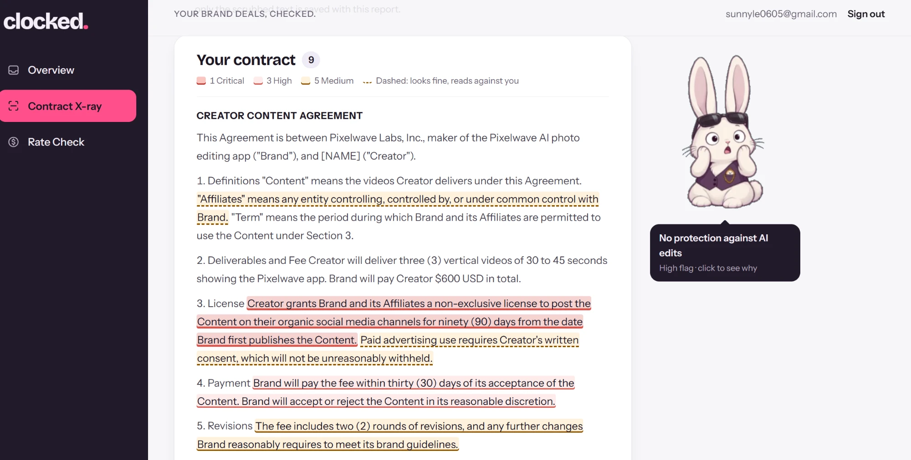
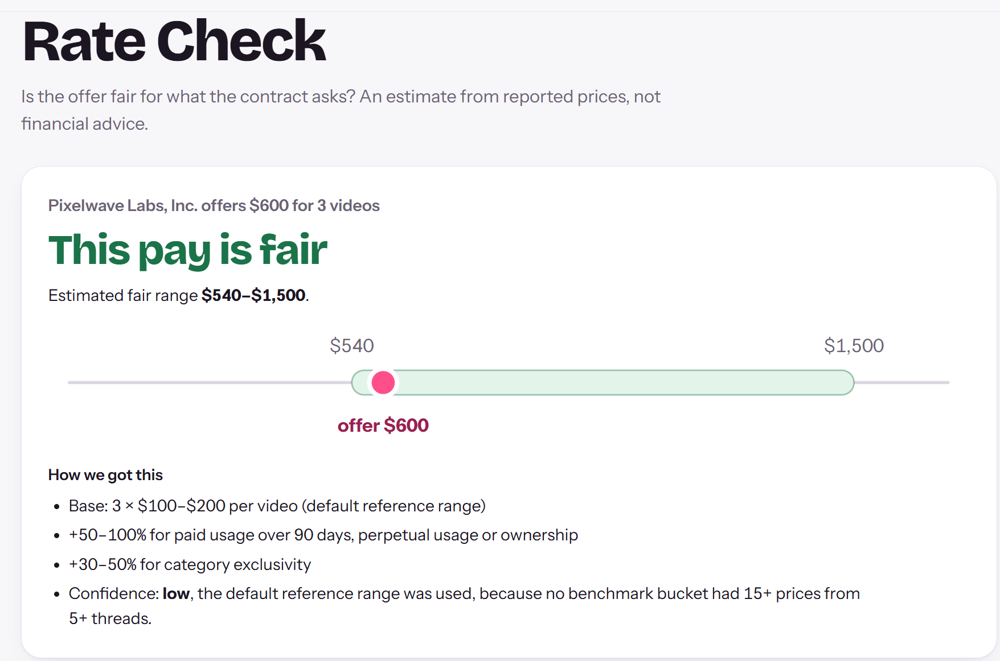
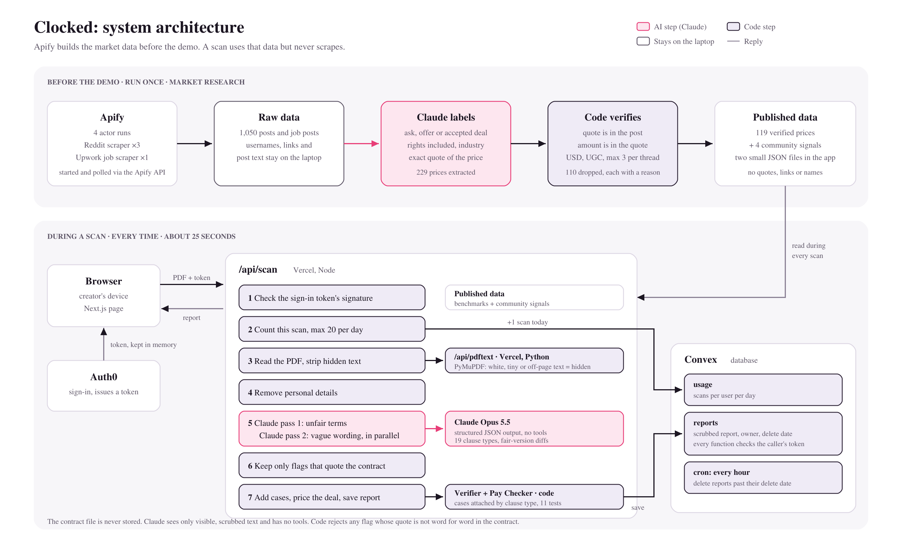

# Clocked

**Brands clocked your engagement. Now clock their contract.**

Clocked is an AI contract reviewer and pay checker for UGC creators. Upload a brand contract as a PDF or a photo. In about 25 seconds you get the risky clauses with a fair rewrite beside each one, the real lawsuit where that wording was fought over, a fair price range from market data we collected and verified with Apify, and a counteroffer.

Built at Cal Hacks 13.0. Live at [ugc-scanner.vercel.app](https://ugc-scanner.vercel.app). Explains contract terms; not legal advice.

## Why

The first time a brand offered Anna money to make content, she thought it was a scam. She had no creator friends to compare notes with, no way to check if the price was fair, and no idea what she was agreeing to. "In perpetuity" means your video works for the brand forever. Broad exclusivity blocks your next deal. An AI-likeness clause decides what a brand can do with your face. A lawyer costs more than the deal, so small creators sign alone.

Clocked is the experienced creator friend Anna wished she had.

## What it does

### Contract X-ray

Every clause is read twice. Pass one catches clearly unfair terms: perpetual usage, paid ads bundled in for free, AI likeness rights, work-for-hire, no kill fee. Pass two catches wording that looks normal but works against you, like a 90-day clock that starts only "when Brand first publishes", so it may never start. Solid highlights are unfair terms. Dashed underlines read fine but can be used against you. Clo lowers her sunglasses when something needs a second look.



Every flag shows the brand's exact words next to a fair version with the changed words highlighted, plus the real case for that clause type (for example Pujols v. Rainbow USA for AI-made images under an "altered" release). Hidden text in the PDF (white, tiny, or off the page) is found by code and shown to you, and never shown to the model.

### Rate Check

Prices the deal against market data. Base rate per video × videos × (1 + uplifts for the rights the contract takes) = fair range. Then a verdict, a counteroffer, the rights you could drop instead, and a confidence level. The math is shown on the page, and thin data says so.



### Community Red Flag Radar

Shows which of your flagged clauses creators on r/UGCcreators are warning each other about right now, from a 250-post sample scraped with Apify: perpetual usage (15 threads), paid ads bundled in (14), performance pay with no minimum (8), raw footage (7).

## System architecture

Two pipelines meet at one small JSON file. The research pipeline runs once, before any scan, and writes the market benchmarks. The scan pipeline runs every time and reads them. A scan never scrapes anything.



Text version: [docs/architecture.txt](docs/architecture.txt).

## Tech stack

Sponsor technologies first.

- **Apify** (market research): `reddit-scraper-lite` and `upwork-job-scraper` actors, started and polled through the Apify REST API. 4 runs, 1,050 posts and job posts. Powers the research pipeline: scrape → personal-information scrubbing → AI price extraction → code fact-check → market benchmarks. [scripts/scrape.mjs](scripts/scrape.mjs)
- **Convex** (database and live backend): per-user reports with owner-scoped functions, a 20-scans-per-day quota, a live-updating scan list, and an hourly cron that auto-deletes expired reports. [convex/reports.ts](convex/reports.ts), [convex/crons.ts](convex/crons.ts)
- **Anthropic Claude Opus 5.5** (the AI layer): a multi-step AI pipeline. Two structured-output passes per contract run in parallel (unfair terms, then vague wording), tool-free by design, every answer fact-checked by code. Offline, the same model extracts prices and classifies community complaints. [lib/scan.ts](lib/scan.ts)
- **Auth0** (sign-in): JWT sign-in, tokens kept in memory, verified server-side against Auth0's JWKS with `jose`. [app/api/scan/route.ts](app/api/scan/route.ts)
- **Next.js 16 + React 19 + TypeScript** on **Vercel**: one page with three views; a Node function runs the scan and a Python function (PyMuPDF) reads PDFs and finds hidden text. [api/pdftext.py](api/pdftext.py)
- **Deterministic verification layer** (our code): hidden-text stripping, personal-information scrubbing, quote-in-contract checks, case lookup by clause type, and a pure-math Pay Checker with 11 tests. The model reads language; code decides numbers and rules. [lib/scrub.ts](lib/scrub.ts), [lib/rate.ts](lib/rate.ts), [lib/rubric.ts](lib/rubric.ts)

## Apify: how we built the market data

Nobody publishes UGC rates, so we built the dataset.

1. **Collect.** [scripts/scrape.mjs](scripts/scrape.mjs) starts each Apify actor through the API, polls it every 15 seconds, and downloads the results. Four runs: rate questions on r/UGCcreators (300 items), one search per brand industry (400), contract complaints for the Radar (250), and Upwork UGC job posts from payment-verified brands (100).
2. **Scrub.** Code removes usernames, names, emails and phone numbers before any post reaches the AI. Raw posts never leave the laptop.
3. **Extract.** Claude reads each post and returns one record per price: the quoted words, the amount, whether it is a creator's ask, a brand's offer or an accepted deal, the rights included, and the brand's industry. [scripts/clean.ts](scripts/clean.ts)
4. **Fact-check.** Code drops a price unless its quoted words appear in the post and the amount appears in the quote. It also drops hourly, non-USD, influencer and advice prices, and keeps at most 3 prices per thread.
5. **Group.** Asks, offers and accepted deals stay in separate groups, and so do rights bundles: $150 for an organic video is never compared with $150 for a video plus a year of paid ads. A group is used for pricing only with 15 or more prices from 5 or more threads.

**Result:** 780 recent items, 229 prices extracted, 119 verified. Each of the 110 dropped prices has a recorded reason. The published files ([data/rates.json](data/rates.json), [data/rate_benchmarks.json](data/rate_benchmarks.json), [data/community_signals.json](data/community_signals.json)) contain no post text, links or usernames.

## AI workflow

A chain of narrow model calls. Each call has a fixed output schema, and code checks each output before the next step.

| Step | AI or code | File |
|---|---|---|
| 1. Read the PDF span by span with color, size and position. White, under-3-point or off-page text is marked hidden and never reaches the model. | **Code** (PyMuPDF) | [api/pdftext.py](api/pdftext.py) |
| 2. Replace names, emails, phones, addresses, handles, SSNs, tax IDs and bank or card numbers with placeholders. | **Code** (11 regex rules) | [lib/scrub.ts](lib/scrub.ts) |
| 3. Pass 1, unfair terms: flags against 19 clause types, plus overall risk, top 3 fixes, missing protections, governing law, and the deal terms used for pricing. | **Claude**, Zod schema, no tools | [lib/scan.ts](lib/scan.ts) |
| 4. Pass 2, vague wording: reads each definition, deadline and condition for small wording with large consequences. Runs in parallel with pass 1. | **Claude**, Zod schema, no tools | [lib/scan.ts](lib/scan.ts) |
| 5. Drop any flag whose quote is not in the contract word for word. Attach the lawsuit and legal note for that clause type. The model never writes a case or a statistic, so it cannot invent one. | **Code** | `checkFlags`, `annotate` in [lib/scan.ts](lib/scan.ts) |
| 6. Pay Checker: fair range = base rate per video × videos × (1 + uplifts). Then verdict, counteroffer, rights to drop instead, confidence. AI likeness rights are never priced, only flagged. | **Code**, 11 tests | `judge` in [lib/rate.ts](lib/rate.ts) |
| 7. Scrub the finished report again, save it to Convex with a delete date. | **Code** | [app/api/scan/route.ts](app/api/scan/route.ts) |

Nothing is trained or fine-tuned. To change what gets caught, edit the rubric.

## Legal rubric

One file our law student can edit: [lib/rubric.ts](lib/rubric.ts).

- 19 clause types in 4 categories. Each has trigger language, a default risk level and a real case (`CLAUSE_TYPES`, `CASES`).
- 5 protections checked in every contract: usage end date, payment date, AI clause, creator approval before publishing, kill fee (`REQUIRED_PROTECTIONS`).
- 12 vague-wording patterns, such as a clock the brand controls, or "may" where "shall" was needed (`VAGUE`).
- Legal notes shown under a flag, written by us so the AI never invents a law: California AB 2602 and the NO FAKES Act status (`LAW_NOTES`).
- Lawyer escalation in code: deals of $5,000 or more, any AI or likeness grant, usage with no end date (`lawyer` in [lib/scan.ts](lib/scan.ts)).
- Pay uplifts from practitioner data: paid usage +20 to 50%, perpetual use or ownership +50 to 100%, exclusivity +30 to 50%, raw footage +30 to 50% (`UPLIFTS` in [lib/rate.ts](lib/rate.ts)).

## Security

| Risk | What Clocked does | File |
|---|---|---|
| One user reads another user's report | Every Convex function checks the Auth0 token and reads only that user's rows. | [convex/reports.ts](convex/reports.ts) |
| Strangers use our AI budget | The scan route rejects requests without a valid Auth0 token, verified against Auth0's signing keys. Each user gets 20 scans per day. The PDF function answers only requests with a secret header. | [app/api/scan/route.ts](app/api/scan/route.ts) |
| Prompt injection in the PDF | Hidden text is removed in code before the model reads. The model has no tools. Each flag must quote the real contract. | [api/pdftext.py](api/pdftext.py), [lib/scan.ts](lib/scan.ts) |
| Personal data reaches the model or the database | Scrubbed before Claude reads the text, and the whole report is scrubbed again before saving. | [lib/scrub.ts](lib/scrub.ts) |
| A stored contract leaks | The file is never stored. It lives in memory for one request. Only the scrubbed report is saved, scoped to its owner, and a Convex cron deletes it one week after the contract ends. | [convex/schema.ts](convex/schema.ts), [convex/crons.ts](convex/crons.ts) |
| A malicious PDF attacks the server | PDFs are parsed in their own short-lived Python function, separate from the app server that holds the user's session. | [api/pdftext.py](api/pdftext.py) |

Also: strict Content Security Policy, HSTS and frame denial in [next.config.ts](next.config.ts).

Known limits: the scrubber is pattern-based, so a name in running text with no label can slip through (next step: an NER pass such as Presidio). A photo is read by Claude before scrubbing, since there is no text to scrub yet; its saved report is scrubbed.

## What we did not fake

- A price group with fewer than 15 prices from 5 threads falls back to the default $100 to $200 range, and the report says "confidence: low". Today no organic-only group is thick enough, because posts rarely say a deal was organic-only.
- Trend numbers are off. Our sample over-represents recent months, so every trend looked like growth.
- Reddit restricts commercial use of its data, so both Reddit pulls are one-time research samples with usernames dropped. A real product should use in-app anonymous reports instead.
- Human spot-check (required by our data spec): `scripts/clean.ts` writes `data/raw/spotcheck.json` (local only) with 30 random prices plus every outlier. 85%+ all-correct means the data can be used.

## Run locally

```bash
npm install
pip install -r requirements.txt
npx convex dev
npm run dev
```

`.env.local` needs `ANTHROPIC_API_KEY`, `NEXT_PUBLIC_CONVEX_URL`, `NEXT_PUBLIC_AUTH0_DOMAIN`, `NEXT_PUBLIC_AUTH0_CLIENT_ID` (and `APIFY_TOKEN` only to re-scrape). `npm test` runs the rate math tests. `npm run demo-contract` rebuilds both demo contracts: `public/demo-contract.pdf` (obvious traps, fake personal details, one hidden line) and `public/demo-subtle.pdf` (reads fair; the traps are a few words).

To rebuild the market data after changing the scrape or clean prompts:

```bash
node --env-file=.env.local scripts/scrape.mjs
node --env-file=.env.local scripts/clean.ts
```

## What's next

- **In-app rate reports:** after a check, ask "what did you end up getting paid?", anonymously, with the rights already extracted. Over time this replaces Reddit.
- **Deal Inbox:** turn brand emails into a pipeline, so Clo catches the contract before you open it.
- **Weekly Apify refresh** with a human spot-check gate before any new data goes live.
